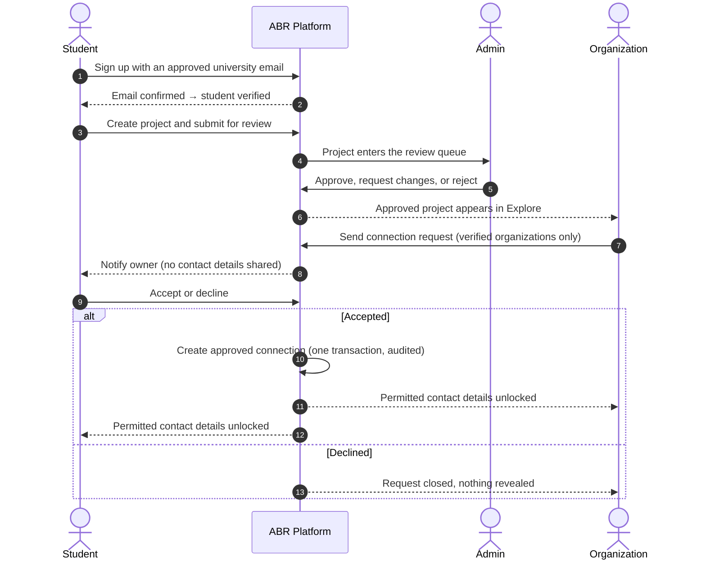
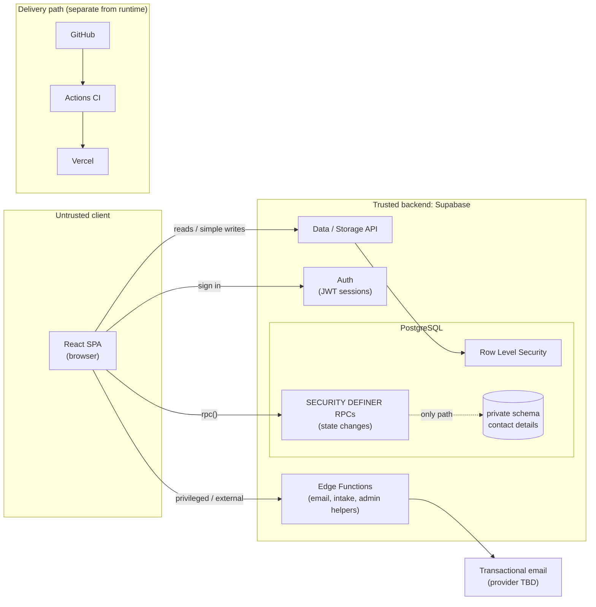

<div align="center">


### Graduation projects deserve a life after graduation.

A verified discovery and connection platform for graduation projects in Saudi Arabia.
<br />
Students, organizations and mentors connect safely, and contact details are shared only when both sides agree.

[Website](https://tryabr.com) · [Jira board](https://tryabr.atlassian.net/jira/software/projects/SCRUM/boards/1) · [Product & Technology Plan v2.0](#documentation)

</div>

---

> **Status:** Sprint 1 in progress (18 Oct – 7 Nov 2026). The target is an internal working build on **31 October 2026**, followed by a pilot-readiness decision on **7 November 2026**. This is not a public release.

## Table of contents

- [About ABR](#about-abr)
- [How it works](#how-it-works)
- [V1 scope](#v1-scope)
- [Tech stack](#tech-stack)
- [Architecture](#architecture)
- [Security model](#security-model)
- [Getting started](#getting-started)
- [Project structure](#project-structure)
- [Development workflow](#development-workflow)
- [Testing](#testing)
- [Bilingual and brand](#bilingual-and-brand)
- [Roadmap](#roadmap)
- [Documentation](#documentation)
- [License](#license)

## About ABR

Every year, Saudi universities produce thousands of graduation projects. Many of them include a working prototype, a real dataset, or an idea an organization is actively looking for. Almost all of them are archived the week after the final presentation.

ABR gives that work a trusted, structured channel to the people who can take it further.

| For | ABR gives them |
|---|---|
| **Students** | A reviewed, discoverable project page, requests from verified organizations and mentors, and control over who receives their contact details. |
| **Organizations** | Admin-reviewed projects from students with verified university emails. They send structured requests and receive contact details only when the student accepts. |
| **Mentors** | A verified professional profile, requests tied to specific projects, and contact shared only for accepted mentorships. |
| **ABR Admins** | Review queues for projects and verifications, with a full audit trail of every decision. |

Verification and privacy are not features added at the end. They are the reason an organization would use ABR instead of a general professional network.

## How it works

Every privacy guarantee in ABR follows from one sequence:

```
Discover  →  Request  →  Accept or Decline  →  Approved Connection  →  Authorized Contact Access
```



Communication continues outside ABR once a connection is approved. V1 has no in-platform chat.

## V1 scope

Full V1 covers 16 capabilities across four domains. Sprint 1 proves the hardest and most valuable slice first: the student → organization journey shown above, end to end.

| Domain | Capabilities | Sprint 1 |
|---|---|---|
| **Accounts & profiles** | Authentication and onboarding · Student university-email verification · Organization profiles and Admin verification · Mentor profiles and verification | First three targeted |
| **Projects** | Project creation and editing · Admin review and publishing · Project exploration and discovery | All targeted |
| **Requests & connections** | Organization → project requests · Accept/decline · Approved connections and contact unlock · Team invitations · Positions and applications · Mentor invitations | Core request type targeted |
| **Platform & trust** | Privacy, permissions and RLS · Notifications · Admin moderation | RLS targeted, minimal notifications |

**Explicitly outside V1:** in-platform chat, AI matching or recommendations, payments and subscriptions, project-management tools, mentor scheduling and ratings, a dedicated backend server, microservices, multi-user organization workspaces, and changeable or multi-role accounts.

## Tech stack

ABR runs on a serverless-first stack, sized for a very small team, with managed services instead of custom infrastructure.

| Layer | Technology |
|---|---|
| Frontend | React · TypeScript (strict) · Vite |
| UI | Tailwind CSS · shadcn/ui (Radix) · Lucide icons |
| Routing and data | React Router · TanStack Query |
| Forms and validation | React Hook Form · Zod |
| Internationalization | i18next: Arabic (RTL) and English (LTR) |
| Backend | Supabase: Auth, PostgreSQL, Row Level Security, Storage, Edge Functions |
| Testing | Vitest · pgTAP · Playwright |
| CI/CD | GitHub Actions · Vercel |
| Project management | Jira (Scrum) |

## Architecture



The architecture has one frontend, one managed backend, and one database, with no custom server.

| Mechanism | Use for | Do not use for |
|---|---|---|
| **Direct table access + RLS** | Lists, details, editing your own profile or draft | Anything that changes status, role, verification, or another user's data |
| **RPC (Postgres function)** | Atomic multi-row changes: submit, review, request, respond, read contact | External services or long-running work |
| **Edge Function** | Email, public endpoints that need abuse controls, service-role operations | CRUD that RLS already covers |

## Security model

> **Threat model:** assume an authenticated user who has the public key, our full frontend source code, and a REST client, and who calls every endpoint directly with crafted inputs. Every control below must hold under that assumption.

- **The server is the boundary.** Authorization is enforced by PostgreSQL RLS, secure database functions, and server-side Edge Functions. The UI hides what users cannot do, but it never decides what they can do.
- **Immutable roles.** A role is fixed at sign-up. Users cannot change their own role or verification status, and Admins are provisioned internally only, never through public registration.
- **Least privilege by default.** Every table has RLS enabled in the same migration that creates it. Client roles get table privileges revoked, then only explicitly editable columns are granted back.
- **Private contact data.** Contact details live in a `private` schema that is not exposed through the Data API. The only read path is `get_connection_contact()`, which checks for an active approved connection and audits every attempt.
- **Atomic state changes.** Submissions, reviews, requests, and responses run through `SECURITY DEFINER` functions with a fixed `search_path`, row locks, and audit events.
- **Secrets stay server-side.** The browser holds only the project URL and the publishable key. CI fails if a secret or service-role key appears in the bundle or the repository.
- **Tested negatively.** Every authorization rule has pgTAP tests proving the forbidden action fails.

Found a security issue? Do not open a public issue. Contact the CTO directly.

## Getting started

### Prerequisites

- [Node.js](https://nodejs.org/) 22+
- [Docker Desktop](https://www.docker.com/products/docker-desktop/), which runs the local Supabase stack
- [Supabase CLI](https://supabase.com/docs/guides/local-development/cli/getting-started)

### Local setup

```bash
# 1. Clone and install
git clone https://github.com/<org>/abr-platform.git
cd abr-platform
npm ci

# 2. Start the local Supabase stack (applies migrations and seed data)
supabase start

# 3. Configure environment variables
cp .env.example .env.local
# Paste the API URL and the publishable (anon) key printed by `supabase status`

# 4. Run the database security tests
supabase test db

# 5. Start the app
npm run dev
```

The app runs at `http://127.0.0.1:5173`. In local development, confirmation emails are delivered to Mailpit at `http://127.0.0.1:54324`.

### Environment variables

| Variable | Description |
|---|---|
| `VITE_SUPABASE_URL` | Supabase project URL |
| `VITE_SUPABASE_PUBLISHABLE_KEY` | Publishable (anon) key, safe for the browser |

> ⚠️ Never put a secret or service-role key in any `VITE_*` variable, in `.env.example`, or in Vercel. `VITE_*` values are bundled into public JavaScript.

### Common commands

| Command | Description |
|---|---|
| `npm run dev` | Start the development server |
| `npm run build` | Typecheck and build for production |
| `npm run lint` | Run ESLint |
| `npm test` | Run unit tests (Vitest) |
| `supabase test db` | Run database and RLS tests (pgTAP) |
| `supabase db reset` | Rebuild the local database from migrations and seed |
| `supabase migration new <name>` | Create a new forward-only migration |
| `supabase gen types typescript --local > src/types/database.ts` | Regenerate database types |

## Project structure

```
abr-platform/
├─ src/
│  ├─ app/              # Providers and root component
│  ├─ components/       # Shared UI: layout, shadcn/ui components
│  ├─ features/         # auth · onboarding · profiles · projects · explore
│  │                    # admin · requests · connections
│  ├─ lib/              # Supabase client, query client, i18n, utilities
│  ├─ locales/          # ar.json · en.json
│  ├─ pages/            # Route-level screens
│  ├─ routes/           # Router and guards (UX only; the database is the authority)
│  └─ types/            # Generated database types
├─ supabase/
│  ├─ migrations/       # Timestamped SQL, forward-only
│  ├─ functions/        # Edge Functions
│  ├─ tests/            # pgTAP security tests
│  └─ seed.sql          # Synthetic local/dev data only
├─ public/              # Fonts, logo, favicon
├─ docs/                # Permissions matrix, decision records
└─ .github/workflows/   # CI
```

## Development workflow

ABR is built with **Scrum**. The backlog, sprints, and acceptance criteria live in [Jira](https://tryabr.atlassian.net/jira/software/projects/SCRUM/boards/1).

### Branches and commits

- `main` is protected. CI must pass, and force-pushes are not allowed.
- Use short-lived branches named after their Jira issue: `feat/SCRUM-13-sign-up`, `fix/SCRUM-21-duplicate-request`, `db/SCRUM-18-projects-schema`.
- Follow [Conventional Commits](https://www.conventionalcommits.org/) and include the issue key: `feat(auth): student sign-up with university email (SCRUM-13)`.
- Open a pull request for every change, even when working alone, so CI and preview deployments run. Each PR states its **authorization impact**.

### Rules that are not optional

1. Every new table enables RLS and revokes default client privileges in the same migration.
2. Status, role, verification, ownership, and recipient fields are never written from the client.
3. Every RPC gets negative tests before its UI is built.
4. Layouts use logical CSS (`ms-*`, `pe-*`, `start-*`), never `ml-*`, `mr-*`, `left-*`, or `right-*`.
5. Every user-facing string lives in `src/locales/`. No hard-coded copy.
6. Schema changes go through migrations only. Never edit shared environments from the dashboard.

### Definition of Done

A story is not done because its screen renders. It is done when all of the following hold:

- [ ] Migration written, reviewed, and applied to development
- [ ] Authorization enforced server-side (RLS, RPC, or Edge Function)
- [ ] Validation on the client (Zod) **and** in the database
- [ ] Loading, empty, and error states handled
- [ ] Arabic RTL and English LTR checked
- [ ] Happy-path tests pass
- [ ] Unauthorized-access tests pass
- [ ] No open critical defects
- [ ] Generated types up to date, CI green
- [ ] Documentation updated (permissions matrix, decisions, changelog)

## Testing

Testing effort is concentrated where a defect would destroy trust: authorization, contact privacy, and state transitions.

| Layer | Tool | Scope | When |
|---|---|---|---|
| Database & RLS | pgTAP | Policies per role, RPC preconditions, immutability, contact access | Every PR |
| Unit | Vitest | Schemas, utilities, hooks | Every PR |
| End-to-end | Playwright | Core journey in Arabic and English | From Week 2 |
| API probing | REST client with real JWTs | Forbidden actions, bypassing the UI | Weeks 2–3 |
| Accessibility | axe + keyboard | Core screens, both directions | Week 3 |

## Bilingual and brand

ABR is designed for Arabic and English together from day one.

- **Arabic (RTL)** uses Tajawal, set one step larger with looser leading. **English (LTR)** uses Inter.
- Layouts mirror automatically. The logo, numbers, and checkmarks are never mirrored.
- The UI implements the **ABR Brand Identity Guidelines v1.0**. Primary actions use Secondary Purple `#7C3AED`, not Pink, so buttons meet WCAG 2.2 AA contrast.

| Token | Value | Use |
|---|---|---|
| Primary Purple | `#4B1C7A` | Headings, key surfaces |
| Secondary (Action) | `#7C3AED` | Buttons, links, active states |
| Accent Purple | `#A855F7` | Focus ring, highlights |
| Pink Accent | `#EC4899` | Gradient start, illustrations (under 5% of a layout) |
| Background | `#FAF9FC` | Main canvas |
| Text Primary | `#1E1147` | Headings and body |

## Roadmap

| Date (2026) | Milestone | Meaning |
|---|---|---|
| 17 Oct | Foundation ready | Scope, brand direction, and architecture confirmed |
| 24 Oct | Foundation and initial flows | Auth, onboarding, verification, profiles, and project submission working |
| **31 Oct** | **Internal working build** | Core student → organization journey works end to end internally |
| **7 Nov** | **Pilot readiness decision** | Evidence-based go / go-with-conditions / not-yet decision |

**After Sprint 1** (proposed, ordered after the 7 November decision): pilot preparation, mentor workflows, team formation, positions and applications, full notifications, Admin moderation, security hardening, and UX refinement from pilot feedback.

## Documentation

| Document | Description |
|---|---|
| ABR Product & Technology Plan v2.0 | V1 definition, architecture, security model, Sprint 1 plan (internal) |
| ABR Brand Identity Guidelines v1.0 | Palette, typography, RTL rules, accessibility (internal) |
| [`docs/permissions.md`](docs/permissions.md) | Role × table × operation matrix, kept in sync with policies |
| [`docs/decisions/`](docs/decisions/) | Architecture decision records |

## License

**Proprietary and confidential.** © 2026 ABR. All rights reserved.

This repository and its contents are for internal use by the ABR team. Copying, distribution, or use without written permission is prohibited.

<div align="center">
<br />
<sub><b>Connect ideas. Create impact.</b></sub>
</div>
